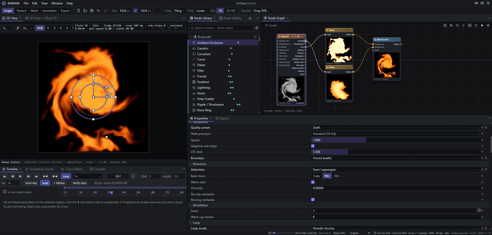

# Kekenik VFX

**Procedural, node-based VFX authoring in your browser — textures, meshes, simulations and flipbooks on WebGPU.**

[](LICENSE)
[](https://github.com/adam1442/kekenik-vfx/actions/workflows/deploy.yml)
[](https://github.com/adam1442/kekenik-vfx/actions/workflows/ci.yml)
[](#browser--gpu-requirements)



## What is Kekenik VFX?

Kekenik VFX is a free and open-source editor for building real-time visual effects assets — tileable textures, looping
flipbooks, normal and flow maps, simple meshes and sweeps, and small simulations — by wiring nodes together. Everything is
computed on your GPU with WebGPU, and everything runs **locally in the browser tab**: there is nothing to install, no account,
no server and no upload of your work.

It is aimed at game and real-time artists who want procedural, resolution-independent assets that export cleanly to game engines.

## Live demo

**<https://adam1442.github.io/kekenik-vfx/>** — needs a WebGPU-capable browser (see [requirements](#browser--gpu-requirements)).

## Features

- **Node-based 2D / 3D graph** with typed pins, subgraphs, groups, comment frames, undo/redo and a command palette.
- **Procedural textures**: noise, fractals, shapes, gradients, scatter, filters, colour tools, curves and gradients, UV and normal-map
  tools, island tools — with per-pixel modulation inputs.
- **Meshes and sweeps with splines**: spline drawing and editing gizmos, resampling, sweeps along curves, point scattering, copy-to-points,
  mesh attributes, GLB / glTF / OBJ import.
- **Simulations**: 2D fluid, vector fields, motion vectors, reaction–diffusion, waves, burn fronts and lightning generators.
  Simulations are deterministic, so exports are reproducible.
- **Flipbooks and looping**: timeline with keyframes, flipbook baking, seamless loops, vertex-animation-texture export.
- **Tileable outputs**: tiling is a graph-wide setting that nodes respect, (see the *Tiling check* sample).
- **Professional export**: PNG (8/16-bit), TGA, OpenEXR, Radiance HDR, uncompressed DDS; GLB, glTF, OBJ, PLY; flipbook sheets with JSON
  sidecars; engine presets; tile-by-tile rendering for very large images; ZIP or folder output.
- **Docking UI**: dock, tab, float and save panel layouts; dark and light themes with a custom accent colour.
- **English and Persian (فارسی) with full RTL layout.**
- **Memory-safe GPU engine**: pooled, budgeted GPU memory; typed out-of-memory handling instead of crashes; automatic device-loss
  recovery; adaptive preview resolution; in-app *safe mode* and GPU diagnostics screen.
- **Private by design**: fully client-side, no telemetry (see [Privacy](#privacy)).
- 22 sample projects, a help panel with the node reference, and 1 100+ unit tests.

The complete list of nodes is in [docs/NODE_REFERENCE.md](docs/NODE_REFERENCE.md). Features that are not implemented are listed in
[docs/ROADMAP.md](docs/ROADMAP.md).

## Screenshots

The hero screenshot above shows the docked editor (graph, 2D viewport, 3D viewport, properties and timeline). Open the
[live demo](https://adam1442.github.io/kekenik-vfx/) and use the **Home** screen to browse the bundled samples.

## Browser & GPU requirements

Kekenik VFX requires **WebGPU** in a secure context (`https://` or `http://localhost`).

| Browser | WebGPU status (best knowledge — always check current support) |
|---|---|
| Chrome / Edge (desktop) | **113+** — enabled by default on Windows, macOS, ChromeOS; Linux depends on version and GPU |
| Firefox | Recent releases (141+ on Windows) — other platforms are rolling out; may need `dom.webgpu.enabled` |
| Safari | **26+** (macOS 26 / iOS 26) — earlier versions need a feature flag |

Browser support changes quickly; check [caniuse.com/webgpu](https://caniuse.com/webgpu) for the current state.

**If your GPU is not detected**, the app shows a *GPU Diagnostics* screen with the failing step, targeted hints, a **Retry** button,
**Continue in limited mode** and **Try software renderer**, and a **Copy diagnostics** button you can paste into a bug report. The
software renderer (a CPU-based adapter) works but is much slower. See [docs/TROUBLESHOOTING.md](docs/TROUBLESHOOTING.md).

## Getting started

### Use it online

Open **<https://adam1442.github.io/kekenik-vfx/>**. Projects are stored in your browser (autosave) and can be saved to and loaded from
files (`.kvfx`).

### Run locally

Requires Node.js 20.19 or newer (the repository pins the LTS used by CI in `.nvmrc`).

```bash
git clone https://github.com/adam1442/kekenik-vfx.git
cd kekenik-vfx
npm ci
npm run dev        # development server (http://localhost:5173)
npm run build      # production build into dist/
npm run preview    # serve the production build locally
```

`npm run build` uses relative URLs by default, so `dist/` can be hosted in any folder. Set `KEKENIK_BASE=/some/path/` to build for a
specific sub-path (the GitHub Pages workflow uses `/kekenik-vfx/`).

## Quick start workflow

1. Open the **Home** screen and pick a sample, or start with *New*.
2. Press **Space** in the graph editor, type a node name (`noise`, `ramp`, `blur`, ...) and add it. Connect pins by dragging.
3. Select a node to preview it in the 2D viewport and edit its parameters in **Properties**. Use the gizmos in the viewport for
   spatial parameters.
4. Set size, tiling and loop length in the graph settings. Animate parameters on the **Timeline**.
5. Add an **Export** node (colour, normal, mask, flipbook, mesh, motion vectors), choose a format and an engine preset, and run
   the export from the **Export** panel.

See the [User Guide](docs/USER_GUIDE.md) for a walkthrough.

## Export targets

Export presets provide sensible defaults (normal-map convention, axes and units, texture size hints, file naming) for **Unreal
Engine**, **Unity** and **Godot**, plus a neutral *None* preset. Details and import-settings cheat sheet:
[docs/EXPORT_GUIDE.md](docs/EXPORT_GUIDE.md). Engine names are trademarks of their respective owners and are used only to describe
compatibility.

## Project structure

```
src/        application source (engine, nodes, panels, ui, export, i18n)
samples/    bundled sample projects
tests/      Vitest suites (no GPU needed)
tools/      contributor tooling (sample generator, i18n audit, size report, notices)
docs/       documentation
public/     static files (icon, manifest, service worker, fonts README)
```

More in [docs/ARCHITECTURE.md](docs/ARCHITECTURE.md).

## Documentation

[User Guide](docs/USER_GUIDE.md) · [Node reference](docs/NODE_REFERENCE.md) · [Export guide](docs/EXPORT_GUIDE.md) ·
[Keyboard shortcuts](docs/KEYBOARD_SHORTCUTS.md) · [Troubleshooting](docs/TROUBLESHOOTING.md) ·
[Developer guide](docs/DEVELOPER_GUIDE.md) · [Architecture](docs/ARCHITECTURE.md) · [Internationalisation](docs/I18N_GUIDE.md) ·
[Performance](docs/PERFORMANCE.md) · [Roadmap](docs/ROADMAP.md)

## Privacy

Kekenik VFX is **fully client-side**. It contains no analytics or telemetry, loads no external fonts, scripts or CDNs, and makes no
network requests at runtime except to load its own static files from the same origin. Your projects and images never leave your
machine unless you export or share them yourself. The optional service worker only caches the app's own files.

## Contributing

Contributions are welcome — see [CONTRIBUTING.md](CONTRIBUTING.md) and the [Code of Conduct](CODE_OF_CONDUCT.md). Good first areas:
new samples, translations, node documentation, exporters and tests. Ideas and known gaps are tracked in
[docs/ROADMAP.md](docs/ROADMAP.md).

## Security

Please report vulnerabilities privately; see [SECURITY.md](SECURITY.md). Questions and help: [SUPPORT.md](SUPPORT.md).

## License

[MIT](LICENSE) © 2026 adam1442. Third-party packages and their licenses are listed in
[THIRD_PARTY_NOTICES.md](THIRD_PARTY_NOTICES.md).

## Acknowledgements

- [three.js](https://threejs.org/) (MIT) for the 3D viewport, and [fflate](https://github.com/101arrowz/fflate) (MIT) for compression.
- The WebGPU and WGSL specification authors and the browser teams implementing them.
- Everyone who reports bugs, translates, and contributes samples.

Kekenik VFX is an independent project inspired by node-based procedural authoring tools and is not affiliated with or endorsed by any
commercial software vendor.

---

## فارسی

**Kekenik VFX** یک ویرایشگر رایگان و متن‌باز مبتنی بر نود برای ساخت افکت‌ها و دارایی‌های بصری بی‌درنگ است: بافت‌های
قابل‌تکرار (tileable)، فلیپ‌بوک‌های حلقه‌ای، نقشه‌های نرمال و جریان، مش و اسپلاین، و شبیه‌سازی‌های کوچک. همه‌چیز با WebGPU روی
کارت گرافیک شما و **کاملاً داخل مرورگر** اجرا می‌شود؛ نصب، حساب کاربری یا ارسال داده‌ای در کار نیست.

- **نسخهٔ آنلاین:** <https://adam1442.github.io/kekenik-vfx/>
- **نیازمندی:** مرورگری با پشتیبانی از WebGPU (مثلاً Chrome یا Edge نسخهٔ ۱۱۳ به بعد) و درایور به‌روز گرافیک. اگر کارت گرافیک
  شناسایی نشد، صفحهٔ «GPU Diagnostics» راهنمایی‌های لازم را نشان می‌دهد؛ می‌توانید «Retry»، حالت محدود یا رندر نرم‌افزاری را امتحان
  کنید. راهنمای بیشتر: [docs/TROUBLESHOOTING.md](docs/TROUBLESHOOTING.md).
- **زبان:** رابط کاربری انگلیسی و فارسی (با چیدمان راست‌به‌چپ) دارد؛ زبان را از «Settings» عوض کنید. بوم گراف، تایم‌لاین،
  ویرایشگر منحنی و ویوپورت‌ها عمداً چپ‌به‌راست می‌مانند. فونت فارسی اختیاری: [public/fonts/README.md](public/fonts/README.md).
- **شروع سریع:** صفحهٔ «Home» را باز کنید و یک نمونه انتخاب کنید؛ در ویرایشگر گراف کلید Space را بزنید و نام نود را بنویسید؛ در
  پایان با نود Export خروجی بگیرید.
- **حریم خصوصی:** هیچ ردیابی یا ارتباط شبکه‌ای (جز بارگذاری فایل‌های خود برنامه) وجود ندارد.
- **مجوز:** MIT. مشارکت و گزارش خطا با زبان فارسی یا انگلیسی خوش‌آمد است: [CONTRIBUTING.md](CONTRIBUTING.md).
